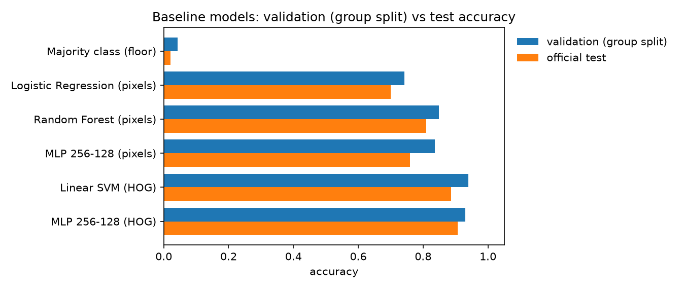
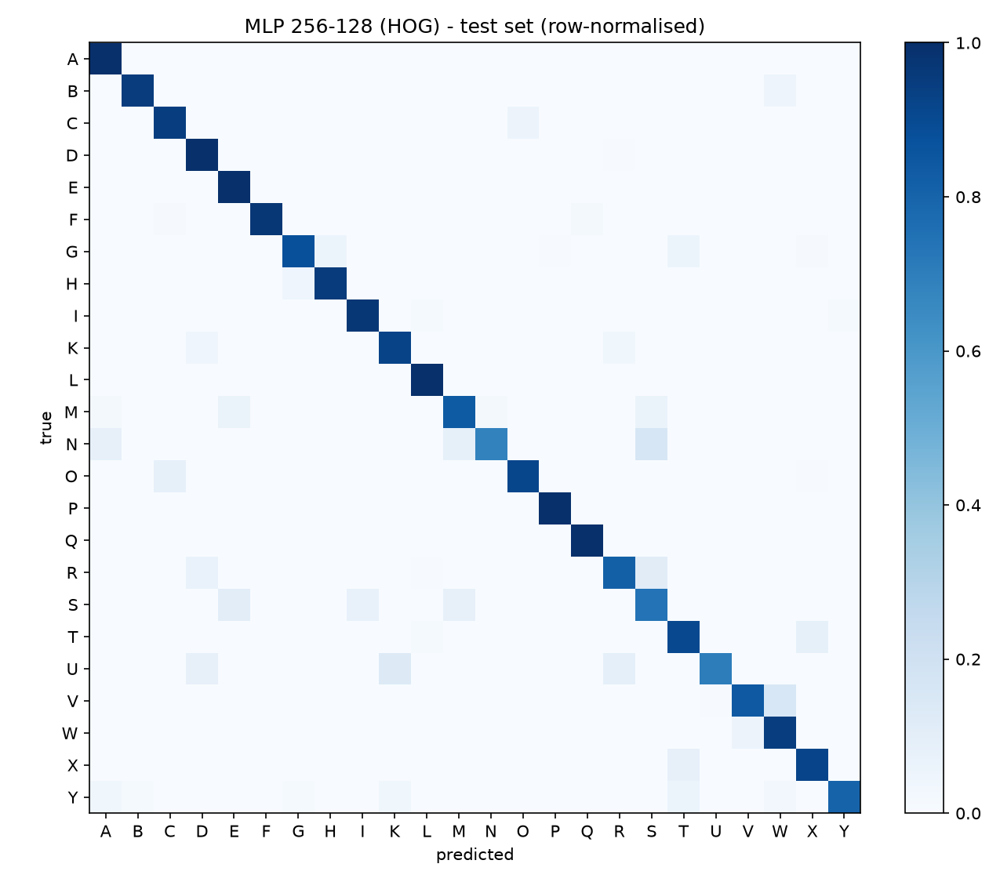

# Week 3 – Data Preparation & Modeling Approach

Project: **Real-time Sign Language Alphabet Recognition Web App**
Dataset: Sign Language MNIST (Kaggle) – 28×28 grayscale hand images, 24 static ASL letters (J and Z excluded because they need motion).

All numbers below come from `python -m src.data`, `python -m src.eda` and `python -m src.train_baselines` (seed 42).

---

## 1. Weekly status (fill in before presenting)

| Item | This week |
|---|---|
| **What** | Data preprocessing pipeline, leakage-free validation split, 5 baseline models, model-selection justification |
| **When** | Pipeline + baselines done; CNN training scheduled for Week 4 |
| **Why** | Baselines set the bar the deep-learning model must beat; pipeline is reused by every later model |
| **Who** | _member → task_ |
| **How much** | _planned hours vs. spent hours, gap, action_ |
| **Top risks** | Validation leakage (found and fixed, §3); domain gap between Kaggle images and real webcam frames |
| **Major changes** | Validation split changed from random to group-based (§3) |
| **Key issues** | PyTorch CNN not yet benchmarked; landmark (MediaPipe) dataset still to be built |

---

## 2. Data preprocessing pipeline

```
Kaggle CSV ──► Quality checks ──► Cleaning ──► Transformation ──► Split ──► Features / Augmentation ──► Models
              missing, dupes,     drop NaN,     label remap        group-     raw pixels | HOG           baselines (wk 3)
              label range,        dupes, bad    0..25 → 0..23,     based      rotation/shift/zoom/        CNN (wk 4)
              class balance       labels        pixels /255        train/val  brightness/contrast
```

### 2.1 Data quality review (`reports/data_quality.json`)

| Check | Result |
|---|---|
| Size | train 27,455 · test 7,172 · 784 pixels + label |
| Missing values | 0 in train and test |
| Exact duplicate rows | 0 within train, 0 within test, 0 shared between train and test |
| Labels | 24 classes; labels 9 (J) and 25 (Z) absent by design |
| Pixel range | 0–255 (valid) |
| Class balance (train) | 957 (E) to 1,294 (R) per letter → max/min ratio 1.35, mildly imbalanced |
| Class balance (test) | 144 (R) to 498 (E) → **distribution differs from train**, so we report **macro-F1** as well as accuracy |
| Hidden issue | **Near-duplicate images.** Kaggle built the training set by augmenting ~1,704 original photos, so each photo appears many times with small changes (see §3) |

Figures: `class_distribution.png`, `samples_per_letter.png`, `mean_per_letter.png`, `brightness_train_vs_test.png`.

### 2.2 Cleaning
No missing values or duplicates exist, but the pipeline still drops NaN rows, duplicate rows and out-of-range labels so it stays safe if the data source changes.

### 2.3 Transformation
- Labels remapped from {0..25} \ {9, 25} to contiguous 0..23 (needed for softmax output).
- Pixels scaled to [0, 1]; models that need it also apply per-pixel z-score using **training statistics only**.
- Images reshaped to 1×28×28 for the CNN.

### 2.4 Splitting strategy
- **Official test set (7,172)**: never used for training or model selection; used only for final reporting.
- **Validation (3,848)** is taken from the official training set with a **group-based stratified split** (see §3). Train keeps 23,607 images.

### 2.5 Feature engineering
| Feature set | Dim | Why |
|---|---|---|
| Raw pixels | 784 | Simplest input; reference point |
| HOG (9 orientations, 4×4 cells, 2×2 blocks) | 1,296 | Encodes finger edges and contour direction, less sensitive to lighting and skin tone than raw intensity |

### 2.6 Data augmentation (for Week 4 CNN)
Random rotation ±10°, shift ±2 px, zoom 0.9–1.1, brightness ±15 %, contrast ±15 %. It simulates webcam variation. **Horizontal flip is disabled** because it turns a right-hand sign into a left-hand sign. Preview: `augmentation_preview.png`.

---

## 3. Key finding: random validation split leaks data

With a normal stratified random split, every baseline scored **≈100 % on validation but only 70–91 % on the test set** (`baseline_metrics_random_split.md`). Validation was useless for choosing a model.

**Cause.** The training set contains about 16 augmented copies of each original photo. A random split puts copies of the same photo in both train and validation, so the model is graded on images it has effectively seen.

**Fix: group-based split.** For each letter, we cluster the images into 70 groups (≈1,704 photos / 24 letters) using 10×10 thumbnails and Ward linkage, so copies of one photo fall in the same group. We then hold out 15 % of the groups of each letter as validation.

| Logistic Regression (pixels) | Val acc | Test acc | Gap |
|---|---|---|---|
| Random split | 1.000 | 0.699 | +0.301 |
| **Group split** | **0.743** | 0.698 | **+0.045** |

After the fix, validation scores track test scores (gap 2–8 points) and the model ranking on validation almost matches the ranking on test (only the top two models swap, and they are within 1 point on validation). Every later model will use this split.

---

## 4. Baseline model metrics (group split)



| Model | Features | Val acc | Val macro-F1 | Test acc | Test macro-F1 | Train (s) | ms/img |
|---|---|---|---|---|---|---|---|
| Majority class (floor) | – | 0.043 | 0.003 | 0.020 | 0.002 | 0.0 | 0.000 |
| Logistic Regression | pixels | 0.743 | 0.742 | 0.698 | 0.680 | 6.3 | 0.004 |
| Random Forest (200 trees) | pixels | 0.849 | 0.846 | 0.810 | 0.792 | 35.9 | 0.032 |
| MLP 256-128 | pixels | 0.838 | 0.838 | 0.761 | 0.736 | 6.1 | 0.006 |
| Linear SVM | HOG | **0.939** | **0.937** | 0.886 | 0.880 | 300.8 | 0.011 |
| MLP 256-128 | HOG | 0.930 | 0.930 | **0.906** | **0.899** | 11.1 | 0.014 |

(CPU, 2 cores. Inference time is per image, batch prediction, features precomputed.)

**What the numbers say**
1. **Features matter more than the classifier.** Moving from raw pixels to HOG adds about 15 points of test accuracy for the same MLP (0.761 → 0.906). Shape and edge information is what separates letters, which a CNN learns automatically.
2. The best baselines are Linear SVM + HOG (best on validation) and MLP + HOG (best on test). They are within 1 point on validation, and MLP trains 27× faster. **MLP + HOG (test macro-F1 0.899) is the bar the Week 4 CNN must beat.**
3. All models are far faster than the real-time budget (33 ms per frame at 30 FPS).

### Error analysis (MLP + HOG, test set)



| True → predicted | Rate | Why they look alike |
|---|---|---|
| N → S | 15.5 % | Closed fist, thumb position differs only slightly |
| V → W | 15.3 % | Two vs. three raised fingers |
| U → K | 13.2 % | Two raised fingers; K adds the thumb between them |
| R → S | 11.1 % | Crossed fingers vs. fist |
| S → E | 10.2 % | Both are fist-like shapes |
| T → X | 8.5 % | Small thumb/index differences |

Weakest letters (F1): S 0.71, R 0.79, N 0.80, W 0.80, U 0.82. Strongest: P, F, Q, L (≥ 0.98).
Fist-based letters (A, E, M, N, S, T) and two/three-finger letters (U, V, W, R, K) are the main source of error, and they answer research question 2.

---

## 5. Model selection justification

| Candidate | Use in project | Reason |
|---|---|---|
| Logistic Regression, Random Forest | Baselines | Fast, interpretable lower bound |
| MLP + HOG | Strong baseline | Shows the value of hand-crafted shape features |
| **CNN (main model)** | Week 4 | Learns local spatial patterns (finger edges, contours) directly from pixels instead of relying on hand-designed HOG. It is translation-tolerant through convolution + pooling, the standard choice for small images, and small enough (~0.4 M parameters) to export to ONNX and run in the browser |
| **MLP on 21 MediaPipe landmarks** | Week 4 (web app path) | Landmarks remove background, lighting and skin-tone effects, so the model is robust on real webcams. Very low compute cost. Needs a landmark dataset (MediaPipe cannot detect hands reliably in 28×28 images) |
| Not chosen: LSTM / RNN | – | The 24 letters are static images with no time dimension. Only relevant if J/Z are added later |
| Not chosen: large pretrained CNN (ResNet etc.) | – | 28×28 grayscale input is too small for it to help, and it is too heavy for real-time inference in the browser |

---

## 6. Planned modelling tasks – Week 4

1. Train the CNN (`python -m src.train_cnn`) with and without augmentation and compare against MLP + HOG (target: test macro-F1 > 0.90).
2. Tune hyperparameters on the **group** validation split: learning rate, dropout, batch size and number of epochs (early stopping on validation macro-F1).
3. Error analysis on the confused pairs above (N/S/M, U/V/W/R/K): confusion matrix and misclassified-image gallery.
4. Build the landmark dataset: run MediaPipe Hands on a colour ASL alphabet dataset or on webcam captures by the team, then train an MLP on normalised landmarks (wrist-centred, scale-normalised).
5. Export the best model to ONNX and measure in-browser FPS (research question 3).

---

## 7. Reproducibility

```bash
pip install -r requirements.txt
python -m src.data
python -m src.eda
python -m src.train_baselines
```
Seed fixed at 42. Raw CSVs go in `data/raw/` (not committed).
